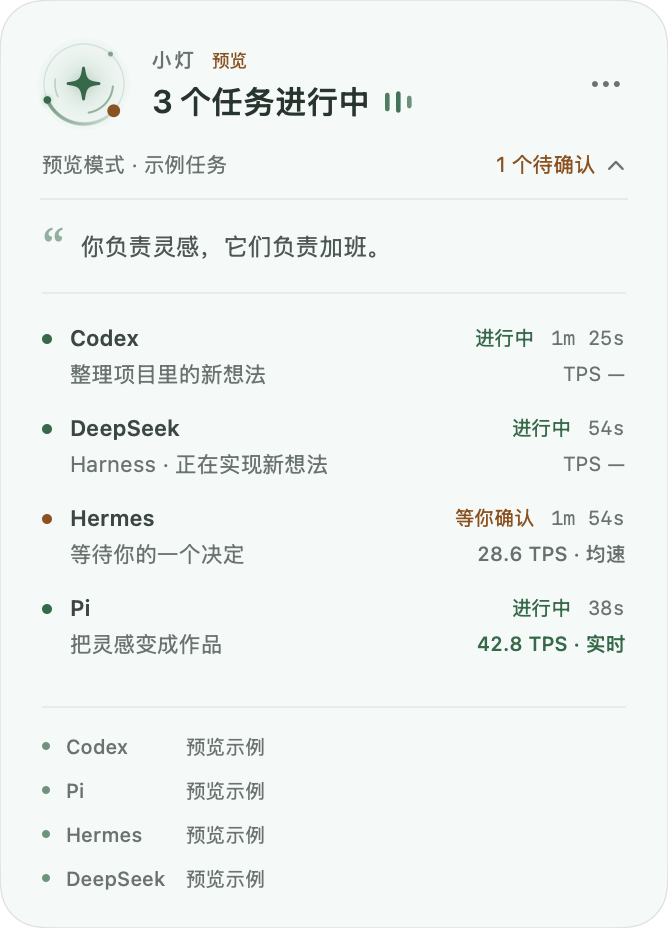

# 小灯 · 智能体工作灯

让桌面上的一盏小灯，告诉你智能体正在忙。

Apple Silicon macOS 14+ 原生 AppKit / SwiftUI 浮窗。显示本机 Codex、Pi、Hermes、DeepSeek Harness 的任务状态，轮播本地趣味文案，并在已接入任务结束时轻声提醒。



## 功能

- 有任务时出现，全部结束后停留 8 秒收起；也可以一直显示。
- 可拖动、不抢键盘焦点，点击展开各个任务和接入状态。
- 本地中文文案随机轮播，默认 20 秒，支持自行编辑句库。
- 跟随系统、深色「夜航」、浅色「晨光」、暖纸「午后」四种主题，自动记住选择。
- 工作核心呼吸、双层光弧旋转与动态信号条；等待时显示琥珀色脉冲，结束时短暂扩散。可关闭动画，并遵循系统「减少动态效果」设置。
- 每个任务独立显示 TPS：明确区分流式实测速度、最近响应均速与暂无数据；不按字符或文字块猜测 token 数。
- 单项任务结束提示音，支持试听、关闭、去重；启动和重连不会补响历史任务。
- 只读本地状态，不调用模型，不上传对话，不结束或重启智能体。

完整说明见 [使用说明](Resources/使用说明.md)。

## 下载与安装

从 [Releases](https://github.com/tangf-ai/agent-lantern/releases/latest) 下载 `agent-lantern-0.5.0-mac-arm64.zip`，解压后将应用放进 `/Applications` 并打开。菜单栏星光图标及浮窗右上角「…」可以打开设置。

Pi 需要独立扩展。使用下面的源码安装方式会一起安装扩展；仅下载应用时，可以从应用包的 `Contents/Resources/agent-lantern.ts` 取出该文件，放到 `~/.pi/agent/extensions/`。新 Pi 会话自动加载，现有终端会话运行 `/reload`。

TPS 支持：Pi 读取流式实际计数或最终响应的 `output` / `durationMs`；Hermes 需启用附带的 `hermes-metrics` 本地插件，按每次响应获取均速；Codex、DeepSeek Harness 暂不提供同口径的 TPS 数值，显示 `TPS —`。详细口径和安装方式见使用说明。

升级已有安装时，先退出小灯并保留旧版应用备份，再替换应用。Pi 与 Hermes 的扩展也需要按使用说明更新并加载；原有文案、主题和位置保存在应用外部。

本版使用 ad-hoc 签名，未经过 Apple 公证；不是公证发行包。Intel Mac、Windows 和 Linux 暂未支持。

## 从源码构建

需要 Swift / Xcode Command Line Tools 和可用的 Python 3。应用运行时使用 `/usr/bin/python3`；Pi 扩展还需要已安装的 Pi。

```sh
git clone https://github.com/tangf-ai/agent-lantern.git
cd agent-lantern
python3 build.py
python3 install.py
```

安装程序会保留已有应用或不同内容的同名扩展并停止，避免覆盖个人修改。构建产物在 `build.noindex/`。

## 接入范围

| 智能体 | 状态依据 | 完成提示依据 |
| --- | --- | --- |
| Codex | 本地 JSONL 生命周期与进程持有的会话文件 | 明确的任务完成事件 |
| Pi | 轻量扩展的任务状态、心跳及进程身份 | 非中断的最终 settled 事件 |
| Hermes | 默认及命名 profile 的任务租约、新鲜网关计数 | 连续观察到租约释放，且原进程仍存活 |
| DeepSeek Harness | 运行进程持有的会话文件及本地 turn / approval 事件 | 明确的 turn/end completed 事件 |

DeepSeek Harness 在浮窗中显示为 `DeepSeek`，支持本机 Desktop 和使用默认 `~/.dsh/sessions` 或当前 `DSH_HOME` 的 Node CLI 会话。压缩会话需要系统中可用的 `zstd` 命令，支持 Homebrew 的标准安装位置；本机已经安装时无需改动 Harness。没有解码器或会话格式不受支持时会明确显示状态未确认。读取只提取生命周期和目录名，不修改 DeepSeek Harness、会话文件或凭据。

DeepSeek Harness 状态更新以其持久化检查点为准；空闲窗口和重启前残留的未结束任务不会直接计入运行数。DeepSeek Harness 的 TPS 暂显示 `TPS —`。

任务数代表已确认接入的工作。远端任务、禁用扩展的 Pi、缺少租约表的旧版 Hermes，以及部分无持久化租约的工作不在完整覆盖范围。只有网关计数而没有租约的 Hermes 工作暂不保证逐项提示音。完成提示代表一次运行结束，不保证业务结果成功。

Codex 和 Hermes 的本地状态格式可能随版本变化；接入异常会显示未确认或未支持，不把应用开着或进程存在直接算成忙碌。

## 验证

```sh
python3 -m unittest discover -s tests -v
node --experimental-strip-types tests/test_pi.mjs
node --experimental-strip-types tests/test_pi_metrics.mjs
mkdir -p build.noindex
swiftc Sources/CompletionGate.swift tests/swift/main.swift -o build.noindex/completion-gate-test
build.noindex/completion-gate-test
```

GitHub Actions 会执行上述检查、构建应用并验证本机签名。

## 源码

- `Sources/main.swift`：原生浮窗、菜单栏、轮播、状态与收起逻辑。
- `Sources/CompletionGate.swift`：完成事件去重、启动及重连静音。
- `Sources/WorkingLight.swift`：原生 Canvas 工作核心和任务信号动画；隐藏、休眠和减少动态效果时停止连续刷新。
- `Resources/collector.py`：Python 标准库只读适配器，以 JSONL 经私有管道交给 GUI；不监听端口。
- `Resources/agent-lantern.ts`：Pi 轻量扩展，原子写入本地状态和心跳。
- `Resources/hermes-metrics`：Hermes 响应统计观察插件，仅记录输出 token 数、耗时及会话/进程身份。
- `Resources/quotes.json`：默认句库。

采集每 2 秒一次，Codex 进程文件归属每 8 秒刷新。首次出现新会话的识别延迟通常不超过 10 秒；已接入会话的结束通常在 2 秒内反映。

可通过 `AGENT_LANTERN_STATE_DIR` 指定隔离状态目录，用于测试。GUI 自己的句库仍使用默认 Application Support 目录。

## 本地数据

句库和 Pi 心跳保存在 `~/Library/Application Support/AgentLantern/`；主题、声音和浮窗位置由 macOS 偏好设置保存。仓库与发布包不包含用户的会话记录、配置凭据或运行数据。

## 开源许可

本项目采用 [MIT License](LICENSE)，允许使用、修改、分发和商业使用，分发时须保留版权声明和许可证。
