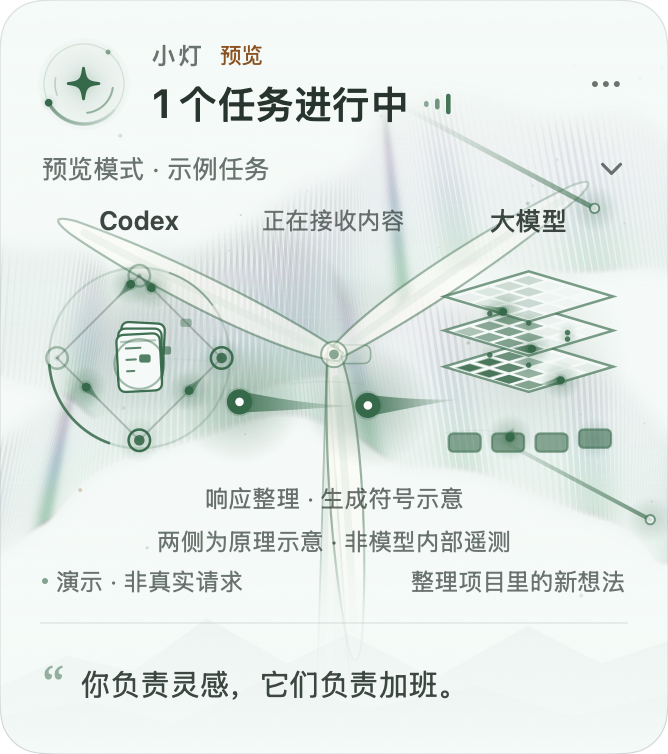
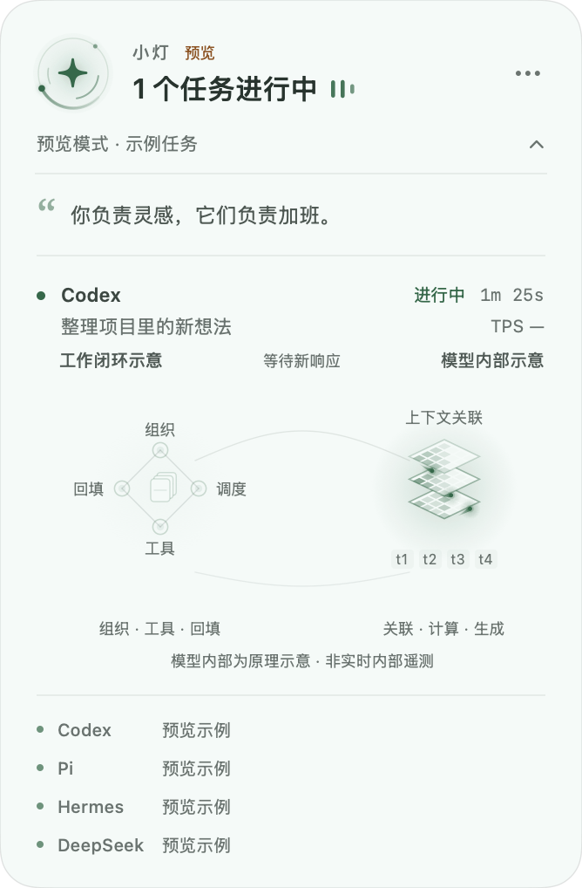
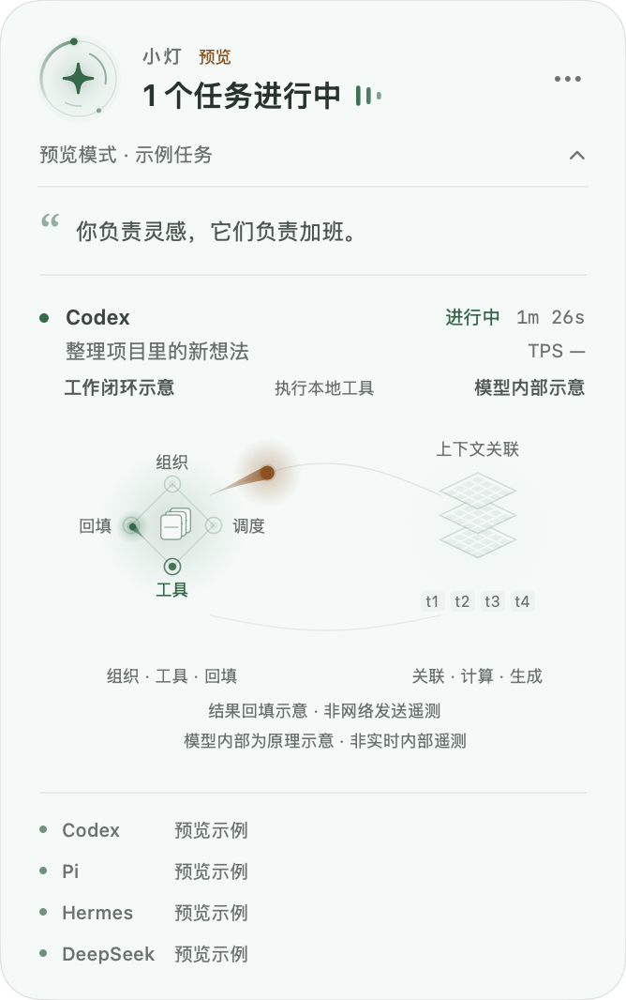

# 小灯 · 智能体工作灯

让桌面上的一盏小灯，告诉你智能体正在忙。

Apple Silicon macOS 14+ 原生 AppKit / SwiftUI 浮窗。显示本机 Codex、Pi、Hermes、DeepSeek Harness 的任务状态，轮播本地趣味文案，并在已接入任务结束时轻声提醒。



## 功能

- 有任务时出现，全部结束后停留 8 秒收起；也可以一直显示。
- 可拖动、不抢键盘焦点，点击展开各个任务和接入状态。
- 本地中文文案随机轮播，默认 20 秒，支持自行编辑句库。
- 跟随系统、深色「夜航」、浅色「晨光」、暖纸「午后」四种主题，自动记住选择。
- 工作核心呼吸、双层光弧旋转与动态信号条；等待时显示琥珀色脉冲，结束时短暂扩散。可关闭动画，并遵循系统「减少动态效果」设置。
- 能量脉冲收发动画；展开后可看智能体工作闭环与模型分层计算示意，明确区分事件状态和原理动画。
- 中间的「微风发电」陪伴动效：风机、草地与轻云，点击可短暂加风，转速不代表 TPS 或任务进度。
- 等高对称的三列图形与更大的字号；仅保留事件驱动的收发光流，背景流星可独立开关、调节亮度。
- 自然极光帷幕、星空与远山背景，默认强度 18%，支持开关、强度和远山设置；极光与流星独立运动。
- 自适应陪伴节奏：运行任务越多、近期新活动越密集，风车与流星平滑加速，极光轻微跟随；排除等待确认和历史活动，可在菜单关闭。
- 每个任务独立显示 TPS：明确区分流式实测速度、最近响应均速与暂无数据；不按字符或文字块猜测 token 数。
- 单项任务结束提示音，支持试听、关闭、去重；启动和重连不会补响历史任务。
- 只读本地状态，不调用模型，不上传对话，不结束或重启智能体。

完整说明见 [使用说明](Resources/使用说明.md)。

## 下载与安装

从 [Releases](https://github.com/tangf-ai/agent-lantern/releases/latest) 下载 `agent-lantern-0.9.2-mac-arm64.zip`，解压后将应用放进 `/Applications` 并打开。菜单栏星光图标及浮窗右上角「…」可以打开设置。

Pi 需要独立扩展。使用下面的源码安装方式会一起安装扩展；仅下载应用时，可以从应用包的 `Contents/Resources/agent-lantern.ts` 取出该文件，放到 `~/.pi/agent/extensions/`。新 Pi 会话自动加载，现有终端会话运行 `/reload`。

TPS 支持：Pi 读取流式实际计数或最终响应的 `output` / `durationMs`；Hermes 需启用附带的 `hermes-metrics` 本地插件，按每次响应获取均速；Codex、DeepSeek Harness 暂不提供同口径的 TPS 数值，显示 `TPS —`。详细口径和安装方式见使用说明。

升级已有安装时，先退出小灯并保留旧版应用备份，再替换应用。Pi 与 Hermes 的扩展也需要按使用说明更新并加载；原有文案、主题和位置保存在应用外部。

本版使用 ad-hoc 签名，未经过 Apple 公证；不是公证发行包。Intel Mac、Windows 和 Linux 暂未支持。

## 从源码构建

需要 Swift / Xcode Command Line Tools 和可用的 Python 3。应用运行时使用 `/usr/bin/python3`；Pi 扩展还需要已安装的 Pi。

```sh
git clone https://github.com/tangf-ai/agent-lantern.git
cd agent-lantern
python3 build.py
python3 install.py
```

安装程序会保留已有应用或不同内容的同名扩展并停止，避免覆盖个人修改。构建产物在 `build.noindex/`。

## 接入范围

| 智能体 | 状态依据 | 完成提示依据 |
| --- | --- | --- |
| Codex | 本地 JSONL 生命周期与进程持有的会话文件 | 明确的任务完成事件 |
| Pi | 轻量扩展的任务状态、心跳及进程身份 | 非中断的最终 settled 事件 |
| Hermes | 默认及命名 profile 的任务租约、新鲜网关计数 | 连续观察到租约释放，且原进程仍存活 |
| DeepSeek Harness | 运行进程持有的会话文件及本地 turn / approval 事件 | 明确的 turn/end completed 事件 |

DeepSeek Harness 在浮窗中显示为 `DeepSeek`，支持本机 Desktop 和使用默认 `~/.dsh/sessions` 或当前 `DSH_HOME` 的 Node CLI 会话。压缩会话需要系统中可用的 `zstd` 命令，支持 Homebrew 的标准安装位置；本机已经安装时无需改动 Harness。没有解码器或会话格式不受支持时会明确显示状态未确认。读取只提取生命周期、收发阶段和目录名，不修改 DeepSeek Harness、会话文件或凭据。

DeepSeek Harness 状态更新以其持久化检查点为准；空闲窗口和重启前残留的未结束任务不会直接计入运行数。DeepSeek Harness 的 TPS 暂显示 `TPS —`。

任务数代表已确认接入的工作。远端任务、禁用扩展的 Pi、缺少租约表的旧版 Hermes，以及部分无持久化租约的工作不在完整覆盖范围。只有网关计数而没有租约的 Hermes 工作暂不保证逐项提示音。完成提示代表一次运行结束，不保证业务结果成功。

Codex 和 Hermes 的本地状态格式可能随版本变化；接入异常会显示未确认或未支持，不把应用开着或进程存在直接算成忙碌。

## 智能体与模型的通信动画



浮窗中显示「智能体 ↔ 大模型」通道，优先展示正在播放近期通信事件的任务，其余任务约每 6 秒轮换；展开后各任务分别显示完整机制图。请求发起后播放一次金色的蓄能、发射与到达扩散，最多 2.8 秒；接收内容时光流回传，并在智能体端产生吸收涟漪。

当前工作阶段与近期通信分别保存。因此模型刚返回工具调用、紧接着开始执行工具时，响应到达仍能显示。短事件从采集器交付后开始有限时长的播放，启动或重连不补播历史，也不会因切换展开方式重播。工具结果准备好时显示「结果回填示意 · 非网络发送遥测」；只有明确请求事件才标记「近期请求发起」。界面中的近期通信是有限时长的事件呈现，不是网络抓包。



智能体端表现组织上下文、调度、工具执行和结果回填的闭环；模型端用层叠矩阵表现常见自回归模型的上下文关联和特征变换，接收期间显示逐 token 生成的符号。图中的循环、层数、格子亮度与 token 方块均为原理示意，不能用于推断真实内部阶段、注意力权重、token 数量或 TPS。模型内部示意始终带文字标识，TPS 仍独立计算。

等待模型响应时，只在模型端播放原理示意；工具执行时只驱动智能体端的原理动画，近期通信光流可以同时播放。已确认结束的响应仅短暂提示到达，随后静止；等待确认、未确认、等待后续事件和历史响应不播放模型计算。收起时保留简化版，避免常驻浮窗占据过多空间。

- Pi：由扩展的请求开始、真实内容增量和工具事件驱动。连续流 3 秒无新内容就停止；近期响应另以有限时长的光点提示到达，心跳不会伪造接收。更新扩展后，新会话自动加载；已有会话需用户自行 `/reload`。
- Codex / DeepSeek：按落盘的响应和工具事件更新，响应到达只短暂提示；缺少请求开始或流式数据时明确显示「收发阶段未确认」。DeepSeek 受持久化检查点影响。
- Hermes：使用已确认的响应结束统计短暂提示；不据此推断当前正在生成。

等待确认优先显示暂停；动画开关、系统减少动态效果和休眠规则继续生效。预览始终标注为演示，不调用模型。仅记录阶段和时间，不保存消息正文。

## 微风发电陪伴动效


在两侧工作机制之间放置一个微型风机场景，收起和展开时均可见。工作时缓缓旋转，全部任务等待确认时平滑降速，点击风机可以短暂加风。风机与当前通信阶段独立，即使暂时没有收发事件也可以作为陪伴动效运行；转速不用于表达模型速度、TPS 或任务进度。

风机与两侧图形使用等高、等距的三列布局，中间保持紧凑。常驻通信连线已去掉，事件驱动的较大光核与拖尾穿过风车，收起和展开均可见；整体字号同步加大。

流星在整个浮窗的背景中斜掠，默认亮度 25%，菜单支持独立开关与亮度选择。它与风车共用可见动画时钟，支持主题、动画开关及系统减少动态效果。背景只是陪伴，不表示网络收发、任务进度或模型内部状态。

极光帷幕在流星下方缓慢变化，用弯曲光带、细密光柱和自然褶皱表现极光场景，并配有星空与远山。默认强度 18%，与流星独立开关和运动；支持强度选择、远山开关及三种主题。它是自然场景的视觉近似，约 12 帧／秒重绘，遵循既有暂停规则。

多个可见风机共用一个时钟，切换智能体、展开或收起不会重置转子。动画开关、减少动态效果、隐藏、休眠及可见区域规则继续生效；暂停后恢复不会快进。全部任务结束后，保留结束状态的风景直到原有八秒提示收起，此时真实任务数为零，通信和模型计算示意保持静止。

## 验证

```sh
python3 -m unittest discover -s tests -v
node --experimental-strip-types tests/test_pi.mjs
node --experimental-strip-types tests/test_pi_metrics.mjs
mkdir -p build.noindex
swiftc Sources/CompletionGate.swift Sources/MessageFlow.swift Sources/TransferPlayback.swift Sources/AnimationTempo.swift Sources/WindMotion.swift tests/swift/main.swift -o build.noindex/completion-gate-test
build.noindex/completion-gate-test
```

GitHub Actions 会执行上述检查、构建应用并验证本机签名。

## 源码

- `Sources/main.swift`：原生浮窗、菜单栏、轮播、状态与收起逻辑。
- `Sources/CompletionGate.swift`：完成事件去重、启动及重连静音。
- `Sources/MessageFlow.swift` / `Sources/MessageFlowView.swift`：有时效限制的阶段解释与双向通信动画。
- `Sources/TransferPlayback.swift`：共享的近期通信播放队列，处理采集延迟、去重、过期与启动静音，独立于当前工作阶段。
- `Sources/MechanismScene.swift`：能量脉冲、吸收涟漪、工作闭环及模型分层计算的原生矢量示意；不读取模型内部信息。
- `Sources/WindMotion.swift` / `Sources/WindGarden.swift`：微风的运动积分、可见视图共用的时钟和原生风机插画，不读取 token 或进度数据。
- `Sources/MeteorBackground.swift` / `Sources/AuroraBackground.swift`：独立的流星与极光陪伴场景；极光使用量化后的共享时钟控制重绘，支持主题、强度和远山设置。
- `Sources/AnimationTempo.swift`：按运行任务和去重后的近期活动选择陪伴节奏；忽略启动、重连历史及等待任务，不估计 CPU、TPS 或任务进度。
- `Sources/WorkingLight.swift`：原生 Canvas 工作核心和任务信号动画；隐藏、休眠和减少动态效果时停止连续刷新。
- `Resources/collector.py`：Python 标准库只读适配器，以 JSONL 经私有管道交给 GUI；不监听端口。
- `Resources/agent-lantern.ts`：Pi 轻量扩展，原子写入本地状态和心跳。
- `Resources/hermes-metrics`：Hermes 响应统计观察插件，仅记录输出 token 数、耗时及会话/进程身份。
- `Resources/quotes.json`：默认句库。

采集每 2 秒一次，Codex 进程文件归属每 8 秒刷新。首次出现新会话的识别延迟通常不超过 10 秒；已接入会话的结束通常在 2 秒内反映。

可通过 `AGENT_LANTERN_STATE_DIR` 指定隔离状态目录，用于测试。GUI 自己的句库仍使用默认 Application Support 目录。

## 本地数据

句库和 Pi 心跳保存在 `~/Library/Application Support/AgentLantern/`；主题、声音和浮窗位置由 macOS 偏好设置保存。仓库与发布包不包含用户的会话记录、配置凭据或运行数据。

## 开源许可

本项目采用 [MIT License](LICENSE)，允许使用、修改、分发和商业使用，分发时须保留版权声明和许可证。
